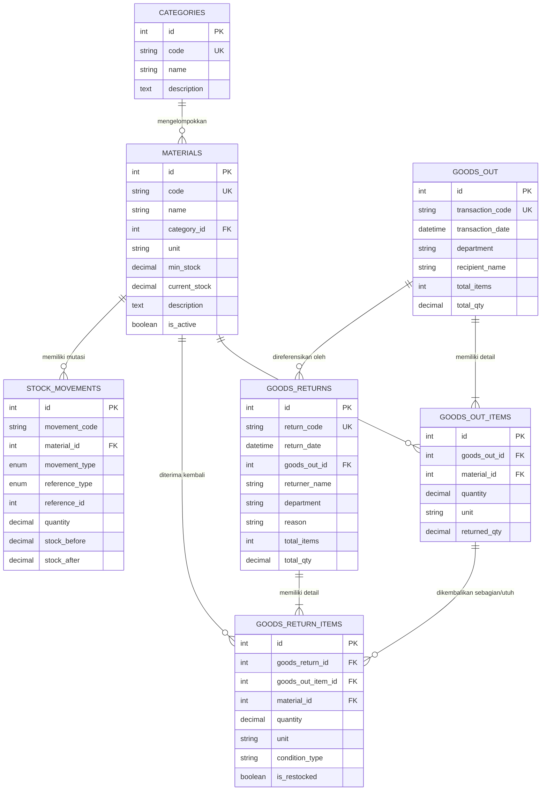

# Sistem Transaksi Bahan Baku (Raw Material Inventory System)
### Studi Kasus 4 — Fullstack Developer Practical Test

Sistem manajemen dan pencatatan transaksi persediaan bahan baku industri yang dibangun dengan arsitektur modern berstandar enterprise. Proyek ini mencakup antarmuka front-end responsif menggunakan **Flutter**, layanan backend REST API menggunakan **JavaScript (Node.js & Express.js)**, basis data relasional **MySQL 8.0** dengan integritas data ACID, serta orkestrasi container menggunakan **Docker & Docker Compose**.

---

## 🌟 Fitur Utama & Alur Bisnis

1. **Master Bahan Baku (Raw Material Catalog):**
   - Pengelolaan data bahan baku: Kode unik (SKU), Nama material, Kategori, Satuan ukuran (UoM), dan Deskripsi/Lokasi rak.
   - Penentuan **Minimum Safety Stock** sebagai batas deteksi stok kritis.
   - Pendaftaran saldo awal (`initial_stock`) yang secara otomatis tercatat ke buku besar mutasi.
   - Fitur **Penyesuaian Stok (Stock Opname)** untuk koreksi fisik berkala dengan alasan dan catatan audit.
   - Pencegahan penghapusan data jika material sudah memiliki riwayat transaksi (Soft Delete / Deaktivasi protektif).

2. **Transaksi Barang Keluar (Goods Out / Material Issue):**
   - Pencatatan pengeluaran bahan baku berdasarkan Departemen/Divisi pemohon dan personil penerima.
   - Mendukung multi-item baris material dalam satu nomor transaksi (`OUT-YYYYMMDD-XXXX`).
   - **ACID Transaction Guarantee & Row-Locking (`FOR UPDATE`):** Memastikan stok tidak dapat menjadi minus dan mencegah kondisi *race condition*.
   - Validasi ketersediaan stok: Jika jumlah yang diminta melebihi stok saat ini, transaksi dibatalkan (*rollback*) dengan pesan galat yang informatif.

3. **Transaksi Pengembalian Barang (Goods Return):**
   - Pencatatan sisa pemakaian atau pengembalian bahan baku dari lantai produksi/proyek (`RET-YYYYMMDD-XXXX`).
   - Fleksibilitas: Dapat mengacu ke nomor transaksi barang keluar (`goods_out_id`) maupun pengembalian bebas/mandiri.
   - **Pengecekan Kuota Retur:** Mencegah pengembalian melebihi sisa volume barang keluar yang sebenarnya (`return_qty <= issued_qty - already_returned_qty`).
   - **Penanganan Kondisi Barang:**
     - *Bagus (Good/Reusable):* Stok otomatis ditambahkan kembali ke inventaris aktif dan dicatat ke kartu stok.
     - *Rusak/Afval (Damaged):* Dicatat sebagai riwayat barang cacat tanpa menambah stok aktif.

4. **Daftar Stok Terkini & Riwayat Transaksi (Kartu Stok / Audit Trail Ledger):**
   - Dashboard KPI interaktif: Total material, jumlah stok aman, stok rendah (*warning*), stok habis, total barang keluar, dan total pengembalian.
   - Kartu stok (*stock ledger*) dengan pencatatan menyeluruh setiap pergerakan stok: Saldo Awal, Barang Keluar, Pengembalian, dan Opname.
   - Pencatatan nilai `stock_before` dan `stock_after` menjamin konsistensi matematis 100%.

---

## 🛠️ Arsitektur Teknologi

| Komponen | Teknologi | Keterangan |
| :--- | :--- | :--- |
| **Frontend** | Flutter 3 (Web, Desktop, Mobile) | State Management: Provider, Google Fonts Inter, Material 3 Design |
| **Backend** | JavaScript (Node.js 22, Express.js) | Layered architecture (Controllers, Services, Middlewares, Validators) |
| **Database** | MySQL 8.0 | InnoDB, Foreign Keys, Unique Indexes, Multi-row Locking ACID |
| **Validasi** | Joi (Backend) & Form Validators (Frontend) | Validasi ganda (sisi klien dan sisi server) |
| **Dokumentasi API** | Swagger UI / OpenAPI 3.0 & Postman | Dokumentasi interaktif langsung di `/api-docs` |
| **Containerization** | Docker & Docker Compose | Multi-container setup (MySQL, REST API Backend, Flutter Web Nginx) |

---

## 🗄️ Struktur & Relasi Database (ERD)

Berikut adalah diagram relasi entitas (*Entity-Relationship Diagram*) basis data:



---

## 🚀 Petunjuk Menjalankan Aplikasi

Aplikasi dapat dijalankan melalui **Docker** (rekomendasi satu perintah) atau dijalankan **secara manual** di lingkungan lokal.

### Metode A: Menjalankan Menggunakan Docker (Direkomendasikan)

Pastikan Docker Desktop sudah terpasang dan berjalan pada sistem Anda.

1. Buka terminal pada folder proyek root (`c:\Users\Lenovo\Kerja\Fullstack Developer Practical Test`).
2. Jalankan perintah:
   ```bash
   docker compose up --build -d
   ```
3. Docker akan secara otomatis mengorkestrasi 3 kontainer:
   - **`raw_material_mysql`**: MySQL 8.0 (Port `3306`), otomatis menginisialisasi skema tabel dan sampel data (*seeder*).
   - **`raw_material_backend`**: Node.js REST API (Port `5000`), menunggu basis data siap (*healthcheck*).
   - **`raw_material_frontend`**: Flutter Web di atas Nginx (Port `8080`).

4. Akses antarmuka web dan API:
   - **Frontend Flutter Web:** [http://localhost:8080](http://localhost:8080)
   - **Interactive API Swagger Docs:** [http://localhost:5000/api-docs](http://localhost:5000/api-docs)
   - **Backend Healthcheck:** [http://localhost:5000/health](http://localhost:5000/health)

5. Untuk menghentikan layanan:
   ```bash
   docker compose down
   ```

---

### Metode B: Menjalankan Secara Manual (Local Development)

#### 1. Inisialisasi Database MySQL
Pastikan server MySQL lokal berjalan di port 3306:
```bash
# Eksekusi file SQL melalui terminal MySQL atau GUI (DBeaver, HeidiSQL, MySQL Workbench)
mysql -u root -p < database/init.sql
mysql -u root -p < database/seed.sql
```

#### 2. Menjalankan Backend REST API
```bash
cd backend

# Salin konfigurasi environment jika perlu
copy .env.example .env

# Jalankan pengujian unit otomatis
npm test

# Jalankan server API (Development Mode dengan Nodemon)
npm run dev
# Server berjalan di http://localhost:5000
# Dokumentasi Swagger di http://localhost:5000/api-docs
```

#### 3. Menjalankan Frontend Flutter
```bash
cd frontend

# Unduh dependensi Dart/Flutter
flutter pub get

# Jalankan pada Google Chrome / Web Browser
flutter run -d chrome
```

---

## 📖 Dokumentasi REST API

API menyediakan dokumentasi interaktif berbasis Swagger/OpenAPI di URL:
👉 **[http://localhost:5000/api-docs](http://localhost:5000/api-docs)**

Koleksi Postman siap pakai tersedia di file [`docs/postman_collection.json`](file:///c:/Users/Lenovo/Kerja/Fullstack%20Developer%20Practical%20Test/docs/postman_collection.json).
Dokumentasi mendalam mengenai setiap rute dan muatan data (*payload*) tersedia di [`docs/api_docs.md`](file:///c:/Users/Lenovo/Kerja/Fullstack%20Developer%20Practical%20Test/docs/api_docs.md).

### Ringkasan Rute API Utama

- **Kategori:**
  - `GET /api/categories` — Mendapatkan daftar kategori
  - `POST /api/categories` — Membuat kategori baru
- **Master Bahan Baku:**
  - `GET /api/materials` — Filter berdasarkan pencarian, kategori, dan status stok
  - `POST /api/materials` — Tambah bahan baku baru (+ saldo awal otomatis)
  - `PUT /api/materials/:id` — Edit master bahan baku
  - `DELETE /api/materials/:id` — Hapus / nonaktifkan bahan baku
  - `POST /api/materials/:id/adjust-stock` — Penyesuaian stok manual (Stock Opname)
- **Transaksi Barang Keluar:**
  - `GET /api/goods-out` — Riwayat barang keluar
  - `POST /api/goods-out` — Proses barang keluar (Atomic Stock Deduction)
  - `GET /api/goods-out/:id` — Detail barang keluar beserta progres retur
- **Transaksi Pengembalian Barang:**
  - `GET /api/goods-returns` — Riwayat pengembalian bahan baku
  - `POST /api/goods-returns` — Proses retur barang (Atomic Stock Increment)
  - `GET /api/goods-returns/:id` — Detail pengembalian bahan baku
- **Kartu Stok & Audit Trail:**
  - `GET /api/stock/overview` — Ringkasan dashboard & status stok kritis
  - `GET /api/stock/movements` — Buku besar riwayat pergerakan stok

---

## 🧪 Validasi & Konsistensi Data

1. **Integritas Transaksi ACID:**
   - Seluruh mutasi stok (`goods_out`, `goods_returns`, dan `adjust-stock`) dijalankan dalam transaksi MySQL dengan perintah `START TRANSACTION`, penguncian baris `SELECT ... FOR UPDATE`, serta penanganan `COMMIT` dan `ROLLBACK`.
2. **Validasi Ganda (Client & Server):**
   - **Frontend Flutter:** Validasi form real-time (tipe data angka, nilai positif, pilihan wajib, pengecekan ketersediaan stok sebelum submit).
   - **Backend Joi:** Skema validasi ketat pada `req.body` untuk menolak data kosong, format salah, atau nilai negatif.
3. **Pencegahan Over-Return:**
   - Sistem melacak field `returned_qty` pada baris barang keluar, sehingga pengguna tidak dapat mengembalikan kuantitas yang lebih besar dari sisa barang yang dikeluarkan.
